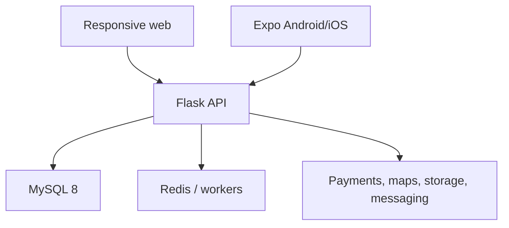
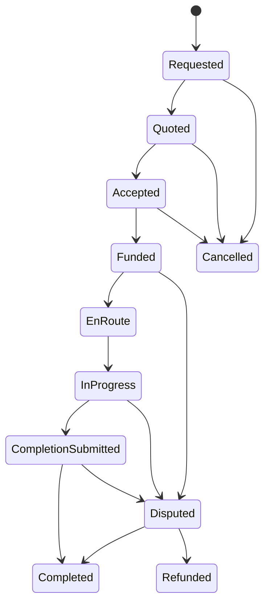

# handEwork Product and Technical Blueprint

Version: 1.0  
Date: 15 August 2026  
Market entry: Ghana  
Tagline: Powering Everyday Work

## 1. Product proposal

handEwork connects customers with skilled workers for location-based, scheduled work. The first supply group is independent artisans and TVET-trained workers. The first customer group is households and small businesses in Ghanaian cities.

The product handles five decisions that are usually scattered across phone calls and WhatsApp:

1. Who can do the work?
2. Are they available near the job?
3. What exactly is agreed?
4. Where is the money while work is underway?
5. What evidence exists if the job changes or fails?

handEwork puts those decisions in one booking record.

## 2. Team

| Person | Responsibility | Delivery ownership |
| --- | --- | --- |
| Phillipa Aidoo, Team Lead and Full Stack Software Engineer | Product, API, web, mobile, data, deployment and delivery decisions | Application architecture, implementation, security controls, release management |
| Christabel Aidoo, UI/UX Designer | Research, flows, interaction and visual system | Customer tests, artisan tests, accessibility, design QA, interface specifications |

## 3. Target users

### Customers

- Households that need trusted local services.
- Renters and property owners coordinating repairs.
- Small businesses that need recurring maintenance and creative work.
- Companies with multiple requesters, locations and approval limits.

### Skilled workers

- Plumbers, electricians, welders and carpenters.
- Hair, makeup, grooming and fashion workers.
- Food, event and hospitality workers.
- Graphic designers, photographers and web workers.
- TVET trainees and graduates building a public work record.

### Partners

- TVET institutions and approved training providers.
- Payment, mobile-money, mapping, identity and communication providers.
- Corporate procurement and facility teams.

## 4. Product principles

- Skill is proved through verification, work evidence and completed jobs.
- Search rankings use service fit, distance, availability and performance. Safety rules can exclude a result.
- The server owns money, booking and permission decisions.
- Provider webhooks, not the browser, confirm payment.
- Exact addresses and identity files are private.
- A public profile never receives a fake rating or sample job.
- A disputed job freezes automatic money movement.
- Country, currency, city, provider and policy are stored separately for expansion.

## 5. Implemented capability map

“Implemented” means the route, model, UI and provider boundary exist in this release. “Activation” identifies an external account or live data requirement.

| # | Capability | Web | Mobile | Server | Production activation |
| ---: | --- | --- | --- | --- | --- |
| 1 | Real distance calculation | Search coordinates | GPS search | Haversine and Mapbox routing adapter | Mapbox tokens |
| 2 | GPS-based artisan matching | GPS capture and query | Location permission and map | Verified/available/radius filters and weighted score | Real artisan coordinates |
| 3 | Artisan portfolio uploads | Portfolio workspace | Photo/video picker | S3 upload and moderation state | S3-compatible bucket |
| 4 | WhatsApp/SMS notifications | Preferences | Account preference surface | Hubtel SMS adapter; WhatsApp provider boundary | Approved sender and template |
| 5 | Push notifications | In-app notification centre | Expo token registration | Expo delivery worker | EAS project, FCM and APNs |
| 6 | MTN MoMo, Telecel Cash, ATMoney | Payment workspace | Mobile-money payment form | Paystack charge and signature verification | Live Paystack Ghana account |
| 7 | handEwork wallet | Balances and transactions | Wallet screen | Currency accounts and auditable ledger | Live payments |
| 8 | Escrow-style flow | Hold/release explanation | Booking payment and state | Held and available ledger buckets; release endpoint | Approved commercial/legal structure |
| 9 | Cancellation/refund | Booking and support routes | Booking/support route | State rules and Paystack refund adapter | Final fee policy |
| 10 | Customer–artisan chat | Conversation workspace | Thread and send | Authenticated REST and Socket.IO | Live API and Redis |
| 11 | Image sharing in chat | Upload-ready thread | Image picker and upload | Private job asset and message URL | Object storage and malware scanning |
| 12 | Artisan calendar | Weekly schedule | Weekly schedule | Unique day/hour records | Artisan input |
| 13 | Instant booking | Profile control | Profile control | Availability and instant-booking flag | Acceptance policy |
| 14 | Scheduled booking | Date/time request | Date request | Scheduled start/end fields | Live booking data |
| 15 | Job tracking | Status timeline | Status timeline | Valid transition map and audit events | Operational use |
| 16 | Before/after photos | Booking and portfolio upload | Job upload | Purpose-tagged file records | Object storage |
| 17 | Dispute resolution | Customer and admin queues | Dispute list | Case, evidence linkage and admin decision log | Trained support team |
| 18 | Admin dashboard | Operations, KYC, payments, risk, analytics | Not an admin target | Role-gated queues and audit logs | Admin account and runbooks |
| 19 | Artisan KYC | Verification workspace | Verification checklist | ID/selfie/trade/payout checks and decisions | Identity provider or manual team |
| 20 | AI-powered matching | Ranked live results | Ranked live results | Explainable weighted matcher; semantic input boundary | Optional model key and evaluated dataset |
| 21 | Fraud/risk detection | Admin risk queue | No manual risk screen | Amount, phone, account-age, velocity and cancellation signals | Tuning from fraud outcomes |
| 22 | Analytics | Admin analytics | Workboard measures | Server totals by time period | Production data and consent controls |
| 23 | Referral system | Referrals workspace | Account route | Unique codes and qualification records | Final reward rules |
| 24 | Promo codes | Validation form | API-ready | Dates, limits, minimum spend and discount rules | Approved campaigns |
| 25 | handEwork Pro | Public offer and artisan route | Workboard access | Subscription record and provider reference | Live plan and price |
| 26 | Business accounts | Business landing | API-ready | Organizations, members, roles and spend limit | Sales approval and billing terms |
| 27 | TVET partnerships | Partner route | Training route | Verified training providers | Signed institution agreement |
| 28 | Training marketplace | No-fake-course empty state | Course-ready client | Published course endpoint | Verified provider and course rows |
| 29 | Multi-city/multi-country | City and locale surfaces | City/locale fields | Country, city, currency and provider separation | Local rules and operating team |

## 6. Architecture

### Web

- Vinext/React with TypeScript and custom CSS.
- Public marketplace and role-specific workspaces.
- Browser token storage is implemented for the current MVP. Move web refresh tokens to Secure, HttpOnly cookies before high-volume public launch.

### Mobile

- Expo SDK 57 and React Native.
- Expo Router, SecureStore, notifications, image picker and rnmapbox.
- A development build is required for Mapbox and push notifications.

### API

- Flask application factory.
- SQLAlchemy, Alembic/Flask-Migrate and MySQL 8.
- Short-lived access tokens and refresh tokens.
- Role checks for customer, artisan and administrator actions.
- Rate limits on account and payment endpoints.
- REST for records and Socket.IO for live job chat.

### Money

- Amounts are stored in decimal GHS values.
- Paystack receives integer pesewa amounts.
- The charge remains pending until a signed webhook reports success.
- Ledger entries are append-only business events.
- Held funds cannot release from the customer path until completion is submitted.
- Dispute decisions and financial endpoints are separated so a support note cannot silently move money.

## 7. Booking state model

## 8. Risk controls

- Unique email, phone, provider reference and idempotency keys.
- Verified payment signatures with constant-time comparison.
- Account and role checks on every private record.
- Booking participant checks for chat and uploads.
- File type and size allow-list.
- Private identity records and moderation state.
- New-account, large-amount, phone-mismatch, velocity and cancellation signals.
- Administrator decisions are written to audit logs.
- No public KYC document URLs.
- CI checks web build, backend tests and migration, and mobile TypeScript.

## 9. MVP rollout

### Gate 1: controlled operations

- One city.
- Two to four service categories.
- 20–50 manually verified artisans.
- Customer request, quote, mobile-money payment, chat, completion and support.
- Support available during operating hours.

### Gate 2: paid public pilot

- Add ratings, referrals, promo codes and handEwork Pro.
- Add payment reconciliation and daily ledger review.
- Measure request-to-quote time, booking conversion, completion, dispute and repeat booking.
- Expand categories only after supply coverage meets the response target.

### Gate 3: business and training

- Company requester/approver roles.
- Monthly invoices and preferred artisan networks.
- Verified TVET partners and published courses.
- Country configuration package before expansion outside Ghana.

## 10. Success measures

| Measure | Definition |
| --- | --- |
| Search coverage | Share of valid searches with at least three available verified artisans inside the selected radius |
| Time to first quote | Median minutes from request to first valid artisan quote |
| Booking conversion | Funded bookings divided by valid requests |
| Completion | Completed bookings divided by funded bookings |
| Dispute rate | Disputed bookings divided by funded bookings |
| Payment reconciliation | Provider success events matched to one internal payment and balanced ledger entries |
| Artisan utilization | Artisans with at least one completed job during the period |
| Repeat booking | Customers with another completed booking within 90 days |

## 11. External approval boundary

The source cannot grant payment, identity, messaging, app-store or legal approval. Before public launch handEwork needs:

- A live Paystack Ghana account and confirmed settlement model.
- Legal approval for escrow language, cancellation, refunds, worker classification, privacy and dispute terms.
- A MySQL backup and restore test.
- A verified SMS sender and WhatsApp templates.
- Mapbox public and secret tokens with the correct scopes.
- S3 retention, deletion and access rules.
- FCM, APNs, Apple Developer, Google Play and EAS ownership.
- Real artisan verification and city coverage.
- A trained administrator and incident contact.

The exact operator steps are in `docs/EXTERNAL_INTEGRATIONS.md`, `docs/DEPLOY_GITHUB_RENDER.md` and `docs/SECURITY_LAUNCH_CHECKLIST.md`.
